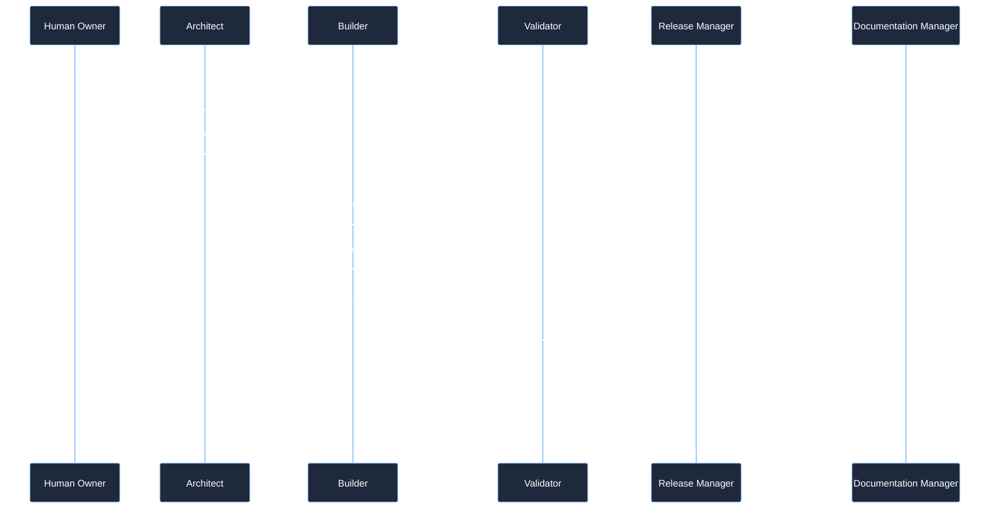
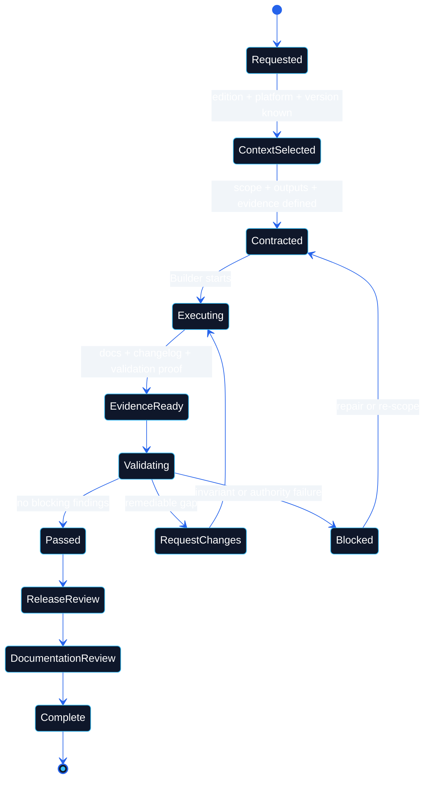
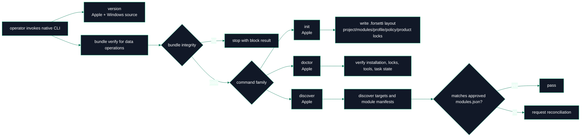
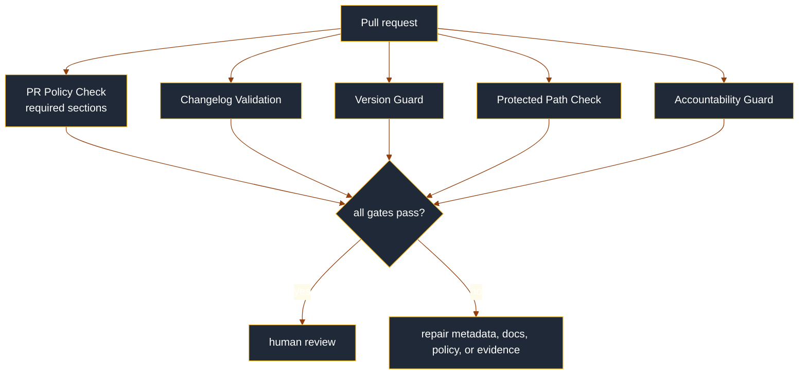

# Workflow

> **Canonical source**: [`AGENTS.md`](https://github.com/flynn33/forsetti-agentic-edition/blob/main/AGENTS.md), [`CHANGE_CONTROL_POLICY.md`](https://github.com/flynn33/forsetti-agentic-edition/blob/main/CHANGE_CONTROL_POLICY.md), [`DOCUMENTATION_POLICY.md`](https://github.com/flynn33/forsetti-agentic-edition/blob/main/DOCUMENTATION_POLICY.md)
> **Last synced**: 2026-10-10, SDK 1.1.0 contracts FAE-GOV-2026-10-10-016 / FAE-TASK-2026-10-10-017 / FAE-REL-2026-10-10-018.

---

## Delivery Pipeline

---

## Governance State Machine

---

## Native Product Lifecycle

SDK consumer onboarding uses `Tools/Initialize-Consumer.ps1` with an explicitly authored context, followed by `Tools/Validate-Consumer.ps1` against a separate target. See canonical [Getting Started](https://github.com/flynn33/forsetti-agentic-edition/blob/main/sdk/Documentation/Getting-Started.md) and [Governance Workflow](https://github.com/flynn33/forsetti-agentic-edition/blob/main/sdk/Documentation/Governance-Workflow.md). Native `init` remains available on macOS but does not manufacture the complete validator context. Native task commands and Windows `doctor` are unsupported.

---

## Command Flow Details

| Workflow | Inputs | Validation Behavior | Outputs |
|---|---|---|---|
| `version` | optional `--format json` | emits structured product version result | product `1.1.0` |
| `bundle verify` | `--bundle-root` | checks manifest presence, schema, safe paths, duplicates, required files, hashes, optional product lock | pass or integrity failure |
| Apple `init` | repository root, bundle root, optional edition/platform/framework/deployment, `--dry-run` | verifies bundle, requires git repo, resolves profile, plans bounded metadata writes | native `.forsetti` records and instruction section; full validator context remains separate |
| Apple `doctor` | repository root, bundle root | verifies bundle, install files, instruction section, profile/policy/product locks, native tools, task state | pass/request/block findings |
| Apple `discover` | repository root, bundle root, optional output | verifies bundle, inspects SwiftPM, Xcode, CMake, MSBuild markers, manifests, module edges, source roots | proposed modules inventory and reconciliation findings |

---

## Local Validator Mode Map

| Mode | Scope | Required Inputs |
|---|---|---|
| `repo` | FFAE repository structure and files | repository root |
| `consumer` | combined SDK target checks, excluding maintainer modes | external SDK, installed target pins/context, authorized contract, manifest when applicable, real changed-file evidence |
| `contract` | task contract scope and evidence gates | contract path, changed-file evidence |
| `project-context` | Forsetti target context completeness | project context path |
| `edition-profile` | selected profile shape and fit | edition profile path |
| `manifest` | module manifest conformance | manifest path and selected profile |
| `dependencies` | dependency direction constraints | changed files, profile, target repo evidence |
| `capabilities` | declared capability before use | manifest and changed files |
| `module-isolation` | direct module boundaries | changed files and module inventory evidence |
| `evidence` | changed-file evidence inputs | real changed-file list and selected profile; native command evidence and independent review remain separate |
| `all` | repository-local aggregate checks | repository root |

---

## Pull Request Gate Flow

---

## Failure Handling Rules

SDK setup supports a no-write dry run and repeated matching runs. Conflicts preserve existing project metadata. Explicit upgrades require the verified prior SDK; changed context, locks, or managed blocks must be reconciled. After an interrupted write, inspect the planned destinations and restore a reviewed backup as needed before rerunning integrity, setup, and target checks. Static validation does not approve a task or prove runtime behavior.

| Symptom | Correct Response |
|---|---|
| Missing task contract | Stop before implementation and create or request the contract. |
| Missing Forsetti project context | Stop Builder execution until edition, platform, version, manifest, capabilities, and API boundary status are known. |
| Bundle hash mismatch | Treat as integrity failure; do not continue native product operations. |
| Unsupported command | Return invalid usage with a blocking finding. |
| Missing validation tool | Report the exact unavailable tool and do not call the check passing. |
| Docs or changelog drift | Update derived surfaces in the same change or record an approved deferral. |
| Direct module edge discovered | Request reconciliation and route interaction through framework public contracts. |

---

**Navigation**: [Home](Home) | [Overview](Overview) | [Compliance](Compliance) | [Agent Roles](Agent-Roles) | [Documentation](Documentation) | [Releases](Releases) | [Changelog](Changelog) | [Constitution](Constitution) | [Glossary](Glossary)
